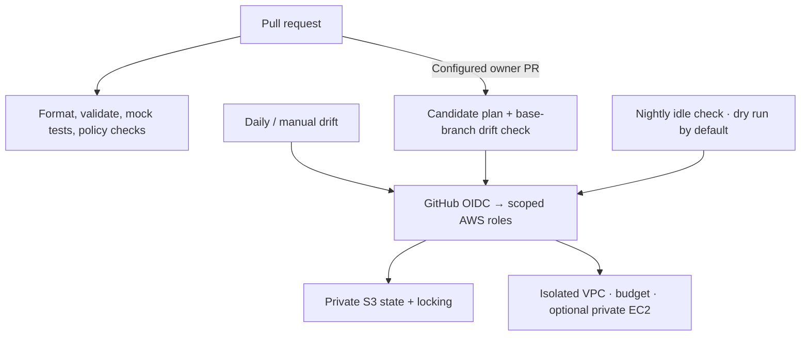

# CloudGuard

**Terraform AWS Cost and Security Baseline** · Terraform · AWS · GitHub Actions

A small project that brings infrastructure, access control, and operating costs into one reviewable workflow. It provisions an isolated VPC and a budget, checks Terraform on pull requests, and can detect drift and stop opted-in demo instances after an hour of low CPU.

The useful part is the connection between the pieces: Terraform defines the baseline, GitHub checks proposed changes, and Python handles the small amount of runtime logic. The project stays within one AWS account, one region, and one demo environment.

**Start without AWS credentials.** The default checks use mocked Terraform providers and fake API clients. Real deployment and AWS workflows are optional, manual setup steps.

## How it fits together



Every PR gets credential-free checks. Once AWS is configured, owner-authored PRs from this repository also get a real plan and a separate drift check against the deployed base branch. GitHub never applies Terraform.

## Run locally

Use Terraform **1.13.5**, Python **3.12.12**, and Make. The versions are recorded in [`.terraform-version`](.terraform-version) and [`.python-version`](.python-version).

```bash
python3.12 -m venv .venv
source .venv/bin/activate
python -m pip install -r requirements-dev.txt
make check
```

This downloads dependencies, then checks formatting and validation, runs Terraform and Python tests, and scans the Terraform source with Checkov. It does not call AWS or create resources. Run `make help` for individual checks.

For a real deployment, follow the [AWS setup and demo walkthrough](docs/aws-setup.md). Defaults are Mumbai (`ap-south-1`), a USD 5 monthly budget, and **no EC2 instance**.

## Find your way around

| Path | What to read or change |
| --- | --- |
| [`modules/vpc`](modules/vpc) | Reusable network module: two isolated subnets and a restricted default security group |
| [`modules/iam`](modules/iam) | Repository-scoped OIDC trust, a plan role, and a separate shutdown role |
| [`modules/budget`](modules/budget) | Monthly account-wide budget with actual-spend email alerts at 80% and 100% |
| [`bootstrap`](bootstrap) | Private, encrypted, versioned state bucket and workflow authentication |
| [`environments/demo`](environments/demo) | Working composition of the modules and an optional private EC2 instance |
| [`.github/workflows`](.github/workflows) | PR checks, optional AWS plans, daily drift, and nightly shutdown |
| [`scripts`](scripts) · [`tests`](tests) | Live Terraform runner, CPU checks, fake API tests, and rejected policy fixtures |

## A few deliberate choices

- **An isolated VPC keeps the demo small.** There is no internet gateway, NAT gateway, public IP, SSH access, or paid network endpoint. The optional EC2 instance demonstrates the controls; it does not host an application.
- **Automation has separate jobs and permissions.** GitHub OIDC provides temporary credentials. The plan role can read the demo and manage its exact state lock; the shutdown role can stop only instances with the required opt-in tags. Apply and destroy stay local and manual.
- **A complete CPU window takes priority over stopping more instances.** Every five-minute average must be below 5% for a full hour. Missing data, recent starts, Spot instances, and Auto Scaling instances are skipped. Shutdown starts in dry-run mode and rechecks state and tags before a real stop.

Shutdown runs at **10:30 p.m. IST (17:00 UTC)**; drift runs daily and on demand. Budget alerts notify rather than cap spending. Low CPU is an idle heuristic, and stopped instances still have storage costs. See the walkthrough for execution controls and cleanup.

## What the checks demonstrate

`make check` verifies the Terraform resource shape and IAM restrictions with mocked providers, exercises plan/drift status handling and shutdown decisions with fake API clients, and applies a focused Checkov baseline. Separate unsafe fixtures must fail checks for public SSH, unrestricted IAM writes, unencrypted EC2 storage, and public instance IPs.

These checks provide repeatable local evidence. A live AWS deployment and GitHub workflow execution have **not been verified here**. The [walkthrough](docs/aws-setup.md#demonstrate-the-behavior) covers the remaining evidence: a real plan, a detected manual change, and an opted-in stop.
